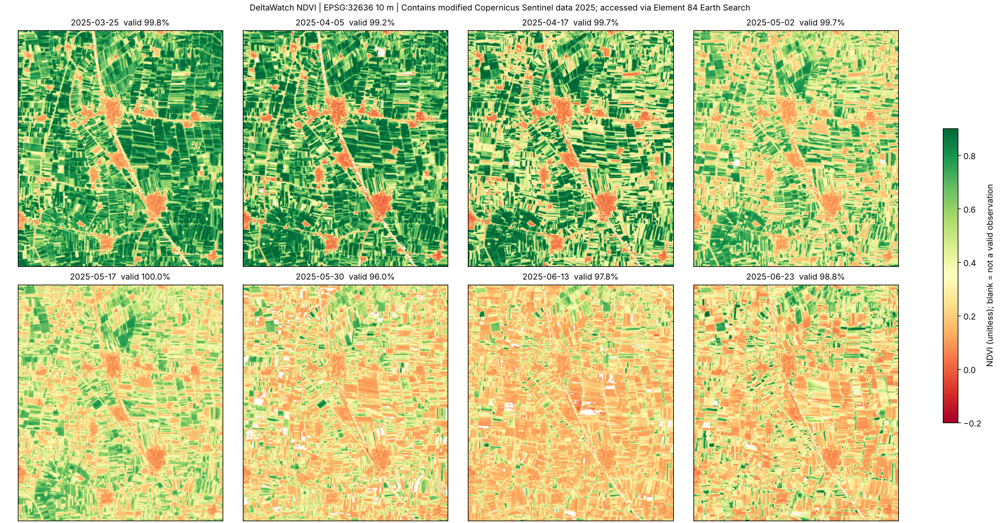
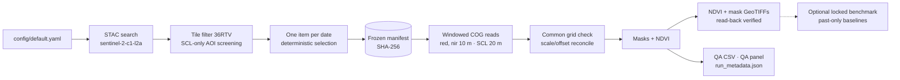
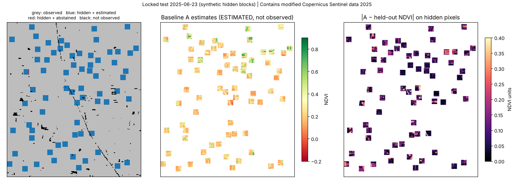

# DeltaWatch

**A reproducible, quality-controlled Sentinel-2 NDVI pipeline for a 5 × 5 km area of the Nile Delta, built on public data and run on a free CPU.**

DeltaWatch turns public Sentinel-2 Level-2A scenes into per-date NDVI GeoTIFFs with explicit validity masks, a QA table and run metadata. The whole run comes from one config file and one frozen source manifest. The project is about engineering quality, not model novelty. That means correct raster handling, provenance you can trace, outputs you can reproduce, and tests that run without a network.



*NDVI for the 8 frozen dates, March to June 2025 (the winter-crop season moving toward harvest). Blank pixels are not valid observations. Contains modified Copernicus Sentinel data 2025, accessed via Element 84 Earth Search.*

## Why these engineering choices matter

| Problem | What DeltaWatch does |
|---|---|
| Scene cloud % says little about a small AOI | Screens every candidate on the **AOI crop's own SCL pixels**, and treats scene cloud only as a discovery filter |
| Overlapping tiles and same-day passes inflate "dates" | Uses one MGRS tile (36RTV) and **one item per acquisition date**, with a documented tie-break (S2A/S2B can both pass on the same day on different orbits) |
| Notebooks that only ran once | A **frozen manifest** (item IDs, asset URLs, checksums, grid, policies) with a SHA-256 fingerprint. Processing refuses a manifest edited after freezing |
| Silent reflectance scaling bugs | Applies `reflectance = DN × scale + offset` **exactly once**, checks STAC against GeoTIFF metadata, and **fails on conflict** without assuming an offset |
| Matching shape ≠ alignment | Snaps every date to one reference grid on the red 10 m tile grid and verifies CRS, transform and shape, not just array size |
| Interpolated class labels | Resamples SCL with **nearest-neighbour only**. Upsampling 20 m SCL does not create 10 m cloud detail |
| Missing data shown as bare soil | Nodata and invalid pixels stay **NaN** in NDVI. Masks are separate uint8 layers with explicit nodata |
| Hidden anomalies | Counts out-of-range NDVI instead of clipping it, and tracks every case back to a non-positive reflectance input |

## Pipeline



`discover` covers search through manifest, and `run` covers manifest through outputs. A fresh session only needs `run`.

## Reproduce from a fresh clone

```bash
# 1. Clone and create a clean environment (Python 3.11-3.13)
git clone https://github.com/ayatfakhry/deltawatch.git
cd deltawatch
python -m venv .venv
source .venv/bin/activate            # Windows: .venv\Scripts\activate

# 2. Install the package with the dev tools (pytest, pytest-cov, ruff)
pip install -e ".[dev]"

# 3. Offline checks: no network needed
pytest --cov=deltawatch               # unit + synthetic end-to-end tests; the live test skips itself
ruff check . && ruff format --check .

# 4. Online: process the frozen manifest (anonymous HTTPS reads of public Sentinel-2 COGs)
deltawatch run --config config/default.yaml --manifest examples/manifest.json --out outputs

# 5. Offline once step 4 has finished
deltawatch benchmark --config config/default.yaml --manifest examples/manifest.json --run-dir outputs
deltawatch compare --manifest examples/manifest.json --run-dir outputs \
                   --reference reference/v0.2/deltawatch_results_v0.2.zip
```

Optional online steps:
- `DELTAWATCH_LIVE=1 pytest tests/live` reads one real COG window anonymously.
- `deltawatch discover --config config/default.yaml --out outputs/manifest.json` re-runs STAC discovery and freezes a **new** manifest. It never overwrites `examples/manifest.json`.

`deltawatch compare` exits with code 0 only when all 16 NDVI and mask rasters match the reference (values including NaN, CRS, transform, shape, dtype, nodata and provenance tags), the QA table matches, and the benchmark settings and scores match. The only fields it tolerates as different are the documented v0.3 protocol fields. Since v0.4, float columns of the QA table are compared with `numpy.isclose` (`rtol=1e-6`, `atol=1e-9`, NaN equals NaN) so that tiny percentile differences between numpy builds do not fail the check; integer, text, date, hash and ID columns are still compared exactly, and the report records the tolerance and the largest absolute and relative difference per float column. Rasters and benchmark scores are still compared exactly.

In Google Colab, `notebooks/demo_colab.ipynb` clones this repository, runs the tests and the pipeline, compares the outputs with the reference and bundles the results into one zip. No AWS credentials, API keys, paid services or GPU are needed.

### What is source, what is reference, what is generated

| Path | Kind | Notes |
|---|---|---|
| `src/`, `tests/`, `config/`, `notebooks/`, `pyproject.toml`, `requirements.txt` | **Source** | |
| `examples/` | **Reference outputs (small)** | Frozen manifest, QA table, panels, run metadata and benchmark results from v0.2. Tests read them, and nothing writes into this folder |
| `reference/v0.2/` | **Reference outputs (full)** | The v0.2 results archive, including the 16 GeoTIFFs. See [`reference/v0.2/README.md`](reference/v0.2/README.md) |
| `evaluations/new_aoi_2026/` | **Separate evaluation (v0.4)** | New AOI and 2026 season; frozen manifest, results and limitations. Its GeoTIFFs are git-ignored |
| `outputs/` | **Generated** | Written by `run`, `benchmark` and `compare`. Git ignores it |

## Measured results (not targets)

All of these numbers come from actual runs on 2026-11-23: a free Google Colab CPU session (Python 3.13.18, GDAL 3.12.2), reproduced in a second Linux environment by the packaged CLI.

| Measurement | Value |
|---|---|
| STAC items returned (Jan–Jun 2025, scene cloud < 60 %) | 144 (36RTV 70, 36RUV 74) |
| Distinct 36RTV acquisition dates | 62 (8 same-day duplicates removed) |
| Dates with ≥ 70 % usable AOI pixels | 50 |
| Frozen dates (window 2025-03-20 to 06-29) | 8, gaps 10–15 days |
| Reference grid | 564 × 489 px, EPSG:32636, 10 m |
| Valid fraction per date | 0.960 to 1.000 |
| NDVI median per date | 0.716 (Mar 25) to 0.199 (Jun 13) |
| Out-of-range NDVI with both reflectances > 0 | **0** on every date |
| Pixels with non-positive reflectance (kept, counted, not valid) | 34 (Apr 5), 75 (Apr 17), 1 (Jun 23) |
| Processing 8 dates, Colab (notebook / packaged CLI) | 16.9 s / 11.9 s measured |
| Peak process RSS, Colab notebook / Colab package / local CLI | 357 / 287 / 213 MB measured |
| Local outputs | 10.8 MB measured |
| Cross-environment check | Colab notebook, Colab fresh-session package run and local CLI produce **identical** QA and benchmark values |
| Offline tests, v0.2 (local and fresh Colab session) | 62 passed, 1 live test skipped by default · 85 % line coverage |
| Offline tests, v0.3 (fresh local clone, Python 3.11, 3.12 and 3.13; not a GitHub Actions run) | 82 passed, 1 live test skipped by default · 85 % line coverage · ruff lint + format clean |
| v0.3 results-preservation check (`deltawatch compare`) | 16/16 rasters, QA table and benchmark scores/settings identical to the v0.2 reference |
| Offline tests, v0.4 (fresh local clone, Python 3.11, 3.12 and 3.13; not a GitHub Actions run) | 100 passed, 1 live test skipped by default · ruff lint + format clean |
| v0.4 results-preservation check | `all_preserved: true`; every QA float column had a maximum difference of 0 in this run |

Per-date details are in [`examples/qa_per_date.csv`](examples/qa_per_date.csv), and the frozen inputs are in [`examples/manifest.json`](examples/manifest.json). Runtime and memory depend on the network and the machine, so they are measurements of these runs, not guarantees.

**Design targets** (budgets we check, not promises): under 2 GB working RAM, under 500 MB local data, zero paid services.

## Optional benchmark: past-only gap filling on synthetic hidden blocks

**Question:** how well do two simple past-only baselines estimate NDVI where otherwise usable target pixels are artificially hidden?

> This is a **synthetic missing-data task** on pixels SCL marks usable. It is **not** recovery of ground truth under real clouds, and SCL itself can be wrong.

**Declared protocol:** the settings are in `config/default.yaml`. The project records that they were fixed on 2026-11-23 before the first scoring. The software reads these settings, but it cannot prove when an earlier run happened.
- Baseline **A**: the latest earlier valid NDVI per pixel, at most 30 days old. Baseline **B**: the median of up to 3 earlier valid observations within 30 days. Both abstain when there is no qualifying observation, and neither uses future imagery.
- Targets were picked by a rule applied to the frozen dates, never to scores: validation **2025-05-17** (seed 101) and locked test **2025-06-23** (seed 202). Each has a different mask layout.
- Non-overlapping 20 × 20 px (200 m) blocks hide about 10 % of the target's observed pixels. The target count comes from the true eligible count, and the run fails instead of weakening the design if it can't be met.
- The predictor receives only the earlier dates and the missing locations. A separate evaluator holds the truth. A test changes the hidden truth and checks that predictions don't change.
- No setting was changed after scoring, and the test split was not used to choose between methods. This is a statement about how the project was run, and the results file records it as a declaration.
- **Input validation (v0.3):** before any score is written, every NDVI and mask file is checked. Each must sit on the manifest grid, follow the data contract (band count, dtype, nodata, mask values {0, 1}, finite NDVI where valid, NaN elsewhere) and carry provenance tags that match the manifest fingerprint, the current processing fingerprint and the manifest item. A run directory from another manifest or another processing policy is rejected with the file and the reason. Nothing is reprojected or repaired.

| Split (target) | Hidden px | Baseline | Predicted px (coverage) | MAE | RMSE | Bias |
|---|---|---|---|---|---|---|
| Validation (2025-05-17) | 27,600 | A latest | 27,570 (99.9 %) | **0.082** | **0.112** | +0.049 |
| | | B median | 27,570 (99.9 %) | 0.130 | 0.165 | +0.104 |
| Locked test (2025-06-23) | 27,315 | A latest | 27,249 (99.8 %) | **0.100** | **0.132** | −0.063 |
| | | B median | 27,249 (99.8 %) | 0.121 | 0.160 | −0.041 |

Errors are in NDVI units, measured on hidden pixels that both baselines predict. Because A and B abstain on the same pixels, the intersection metrics are identical to these.

**Reading it honestly:**
- A beats B on both splits. NDVI changes fast in this season (harvest), so older observations add lag: B is biased high on 05-17 while NDVI was falling, and both are biased low on 06-23 after new growth started.
- With 10–15 day spacing, only **2** earlier dates fall within 30 days of either target, so B is effectively the mean of the 2 latest observations, not a 3-observation median.
- These are two target dates on one tile and one season. They describe this setup, not general gap-filling skill.



Reproduce: `deltawatch benchmark --config config/default.yaml --manifest examples/manifest.json --run-dir outputs`. The full results with mask parameters and provenance are in [`examples/benchmark_results.json`](examples/benchmark_results.json).

## Separate evaluation: new AOI, 2026 season (v0.4)

The same two baselines, with unchanged settings, were evaluated on a new area (eastern Delta, `[31.60, 30.60, 31.65, 30.65]`, tile 36RUU) and season (2026-05-20 to 09-30). Every rule (tile choice, date selection, targets, seeds 301–305, block bootstrap) was written in `config/eval_new_aoi_2026.yaml` before discovery, and the manifest was frozen before anything was scored. There were 9 targets × 5 mask layouts, with no failures and nothing dropped. A had a lower MAE than B in all 45 runs, and the gap was largest during the July green-up, when both baselines under-predict. This is one AOI and one season, so there is no pooled number. Details, the full table and the limitations are in [`evaluations/new_aoi_2026/README.md`](evaluations/new_aoi_2026/README.md).

## Quality policy

- **Usable SCL classes:** 4 (vegetation), 5 (not vegetated), 6 (water). Everything else is excluded. This is a conservative project policy, and SCL is **not** a verified ground-truth cloud mask.
- **NDVI validity:** usable SCL class, finite reflectances, `nir + red > 1e-4`, and both reflectances > 0.
- **Dilation:** one native SCL pixel around classes 3, 8, 9 and 10 is computed and its effect recorded (`valid_fraction_if_dilated`). It is not applied. On the frozen dates it changed the valid fraction on one date only (0.9971 → 0.9969).

## Repository layout

```
config/default.yaml        single source of truth for discovery and processing
src/deltawatch/            config, catalog (STAC + selection), raster, manifest, pipeline + CLI, benchmark, reference, evaluation
tests/                     offline tests (synthetic rasters) + tests/live (opt-in smoke test)
notebooks/demo_colab.ipynb thin notebook calling the package
examples/                  small v0.2 reference outputs: frozen manifest, QA table, panels, benchmark results
reference/v0.2/            full v0.2 results archive (GeoTIFFs included) used by `deltawatch compare`
config/eval_new_aoi_2026.yaml, evaluations/new_aoi_2026/   separate v0.4 evaluation on a new AOI and season
.github/workflows/ci.yml   GitHub Actions definition: lint + offline tests on Python 3.11-3.13
```

## Known limitations and failure modes

- **Two viewing geometries:** the frozen dates come from relative orbits 021 (incidence ≈ 10.7°) and 064 (≈ 5.1°). The pipeline applies no BRDF normalisation, so small NDVI differences can come from view angle and not from vegetation.
- **SCL errors pass through:** misclassified cloud, shadow or haze labelled as class 4/5 count as valid. Unclassified pixels (class 7, often along roads and canals) are excluded.
- **Slightly negative reflectances** appear in dark pixels after the −0.1 offset. They are flagged and excluded from NDVI validity but kept in the counts.
- **Single tile, small AOI:** the AOI is in the 36RTV/36RUV overlap. Moving it outside 36RTV raises an error instead of mosaicking.
- **External services:** the Earth Search API and COG hosting can change. The manifest stores asset URLs and checksums, but it does not archive the pixels.

## Why a CPU baseline is the right first version

The question in v1 is whether the data are handled correctly, not which model is best. A small, transparent CPU pipeline makes every scaling, masking and alignment decision testable and cheap to rerun, and it gives any later method a trustworthy input and an honest baseline to beat. Deep learning, multi-sensor fusion, web apps and cloud deployment are intentionally out of scope.

## Status

- [x] Milestone 1: one date, verified grid/mask/scaling, NDVI preview
- [x] Milestone 2: config-driven multi-date core, QA exports
- [x] Milestone 3: package, offline tests, CI config, fresh-session run
- [x] Milestone 4: locked past-only temporal gap-filling benchmark (results above)
- [x] v0.3: real repository layout, benchmark input validation, results-preservation check
- [x] v0.4: CI workflow in its proper path, float tolerance in the QA comparison, separate new-AOI 2026 evaluation
- [ ] GitHub Actions: the workflow is defined in `.github/workflows/ci.yml`. It has no recorded run yet, so no CI status is claimed here

## Data, attribution and license

Contains modified Copernicus Sentinel data 2025 and 2026. Accessed through the Element 84 Earth Search STAC API and the Sentinel-2 L2A COGs on the Registry of Open Data on AWS. See [THIRD_PARTY_NOTICES.md](THIRD_PARTY_NOTICES.md). The satellite data terms are separate from the code license. The code is released under the [MIT License](LICENSE).
