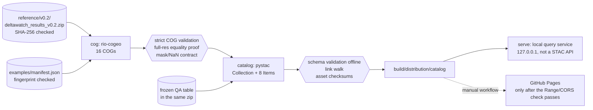

# DeltaWatch distribution layer: COGs, static STAC catalog, local query

This layer packages DeltaWatch's **frozen** outputs so they can be browsed, checked and (where the host verifiably supports it) streamed without cloning the repository. It is a distribution layer, not new analysis: it never runs the NDVI pipeline, never changes its config or outputs, and lives in its own package, `deltawatch.distribution`. (`deltawatch.catalog` already exists for the pipeline's STAC *discovery*, so the name `catalog` could not be reused.)

## Architecture



Layout (generated, git-ignored, rebuilt by one command):

```
build/distribution/catalog/
├── catalog.json
└── deltawatch-ndvi/
    ├── collection.json
    └── 2025-05-30/
        ├── deltawatch-ndvi-2025-05-30.json   STAC Item
        ├── ndvi_2025-05-30.tif               COG, float32, nodata NaN
        ├── valid_2025-05-30.tif              COG, uint8 {0,1}, nodata 255
        └── thumbnail_2025-05-30.png          preview only, not data
```

Every href is relative and the catalog has no `self` links (STAC "self-contained"), so the same folder works from disk, from the local service, or from any static host.

## Rebuild (one command)

```bash
pip install -e ".[dev,distribution,query]"      # the distribution extras need Python >= 3.11
deltawatch-dist build                            # COGs + catalog + all reports; non-zero exit on any failure
pytest tests/test_distribution_*.py
```

`build` writes `reports/distribution/`: `cog_validation_report.json`, `cog_equality_report.json`, `cog_build_report.json` (settings, tool versions, size and SHA-256 per file) and `catalog_validation_report.json`. The build is deterministic within one environment: two builds give byte-identical files (tested). GDAL versions can change the bytes. That is why preservation is proven by decoding and comparing pixels, not by checksums.

## Part A: COGs and the equality proof

Settings, each with its reason, are in [`config/distribution.yaml`](../config/distribution.yaml): 256 px blocks (the grid is only 489 × 564), lossless DEFLATE with the source predictors (3 for float, 2 for uint8), two internal overview levels, overview resampling **average** for NDVI (continuous; GDAL skips NaN) and **mode** for the mask (categorical; no invented values). The config loader refuses a non-categorical resampling for the mask.

The frozen source GeoTIFFs are tiled but **not** valid COGs (rio-cogeo: main IFD at offset 872942, no overviews). Measured in this build:

| Check | Result |
|---|---|
| rio-cogeo validation, strict (warnings fail too) | 16/16 valid, 0 errors, 0 warnings |
| Full-resolution equality with the source (values NaN-aware **and bit-for-bit**, NaN positions, GDAL mask, CRS, transform, shape, dtype, nodata, scale/offset, every provenance tag) | 16/16 identical |
| NDVI/mask contract (mask = 1 exactly where NDVI is finite, 0 exactly where NaN) | 8/8 dates |
| Total COG size | 9,293,820 bytes |

The tests also prove that the comparison **can fail**: a one-ULP pixel change, NaN → 0, a signed-zero flip, a nodata change, an altered provenance tag and a flipped mask pixel are all detected. A wrong archive checksum or a date outside the frozen manifest stops the build.

Overview note: the width is odd (489), so GDAL's /2 overview is 245 px wide and its windows are not exact 2 × 2 blocks. This changes overview values only, never full resolution.

## Part B: STAC catalog (STAC 1.1.0, pystac 1.16.1)

Where each field comes from:

| Field | Source |
|---|---|
| `datetime` | the COG's `acquired` tag (sensing time of the source item) |
| `geometry`, `bbox` | raster bounds reprojected to EPSG:4326 |
| `proj:code`, `proj:shape`, `proj:transform`, `proj:bbox` | the COG header |
| `raster:bands` `nodata`, `data_type`, `spatial_resolution`, `sampling` | the COG header (`AREA_OR_POINT=Area`) |
| `raster:bands.statistics` (NDVI) | computed from the COG's valid pixels |
| `classification:classes` (mask) | parsed from the mask's own `values` tag |
| `file:size`, `file:checksum` (SHA-256 multihash) | the built files |
| `platform`, `deltawatch:source_item`, `deltawatch:*_sha256` | frozen manifest and COG provenance tags |
| `eo:cloud_cover` | share of SCL classes 8, 9, 10 inside the AOI, from the frozen QA table. SCL is not verified ground truth, so this is an estimate |
| `deltawatch:valid_fraction` | frozen QA table |

**Left out on purpose** (not known from the data): band `unit` (the files carry none; NDVI is unitless and the asset description says so), `gsd`, `instruments`, `constellation`, view/sat angles, `created`/`updated` timestamps (they would break byte-stable rebuilds). The license is `other` with a link to the Copernicus Sentinel data legal notice. The code's MIT license does not cover the data.

Validation: every JSON document is validated against the core and extension schemas **that ship with pystac**, so the check runs offline (a test blocks the network to prove this). A link walk follows every relative link and asset href, and `deltawatch-dist verify` recomputes every asset checksum against its Item. Result: 10 documents, 60 internal links, 0 broken, 24/24 asset checksums match.

## Part C: minimal local query service

```bash
deltawatch-dist serve        # http://127.0.0.1:8000 ; interactive docs at /docs
curl "http://127.0.0.1:8000/search?datetime=2025-05-01/2025-05-31&bbox=30.92,30.92,30.93,30.93"
```

This is **a minimal local query service over the static catalog. It is not a STAC API.** No STAC API conformance suite was run, and it claims no conformance. Endpoints: `/`, `/collection`, `/items/{id}`, `/search?datetime=&bbox=&limit=`, and `/files/...` for the catalog files. `datetime` accepts RFC 3339 instants or intervals (`A/B`, `../B`, `A/..`), plus plain dates as inclusive whole UTC days. `bbox` is `minlon,minlat,maxlon,maxlat` and is matched by intersection with the Item bbox. Bad input returns 4xx.

Local streaming, verified: `/files` answers Range requests with `206 Partial Content`, and tests compare the first 1,024 bytes with the file. In a manual check, GDAL opened `http://127.0.0.1:8765/files/deltawatch-ndvi/2025-05-30/ndvi_2025-05-30.tif` and read a 64 × 64 window with one HEAD and two `206` range GETs. The window was identical to the local file. No map-tile server (titiler) is included.

## Hosting: GitHub Pages (NOT YET VERIFIED)

Status: **not published and not verified.** Until the check below passes on the live site, this README promises no streaming and gives no "Browse" link.

1. Make sure the repository is public (Pages on GitHub Free needs a public repository), then set Settings → Pages → Source: **GitHub Actions**.
2. Run the manual workflow **pages-catalog** (`.github/workflows/pages.yml`). It rebuilds and validates from the frozen archive, then deploys `build/distribution/catalog`.
3. Check the live site:
   ```bash
   deltawatch-dist check-hosting \
     --cog-url     https://<user>.github.io/deltawatch/deltawatch-ndvi/2025-05-30/ndvi_2025-05-30.tif \
     --catalog-url https://<user>.github.io/deltawatch/catalog.json \
     --origin      https://radiantearth.github.io
   ```
   This sends `GET` with `Range: bytes=0-1023` and `Origin`, and passes only if the COG answers `206` with the right `Content-Range` and 1,024 bytes, and both the COG and `catalog.json` return an `Access-Control-Allow-Origin` that allows the origin. The exact request and response are written to `reports/distribution/hosting_check.json`. Paste them here.
4. If the check passes: add the STAC Browser link (`https://radiantearth.github.io/stac-browser/#/external/<user>.github.io/deltawatch/catalog.json`) **only after opening it and seeing the catalog render**. If it fails: keep the catalog for browsing, state that streaming is not supported, and browse locally instead ([STAC Browser local files](https://github.com/radiantearth/stac-browser/blob/main/docs/local_files.md), or `deltawatch-dist serve`).

Documented GitHub Pages limits, read on 2026-11-23 from [GitHub Pages limits](https://docs.github.com/en/pages/getting-started-with-github-pages/github-pages-limits) (re-check at publish time): published sites "may be no larger than 1 GB"; a *soft* bandwidth limit of 100 GB per month; deployments time out after 10 minutes; rate limits may apply (HTTP 429); Pages "is not intended for or allowed to be used as a free web-hosting service to run your online business". Our published folder measures **10,663,928 bytes** (about 1 % of the size limit). The bandwidth limit is soft and documented, not a guarantee, so no free bandwidth beyond it is promised.

## Versions

Tested on 2026-11-23 with Python 3.13.18, GDAL 3.12.2, rasterio 1.5.2, rio-cogeo 7.0.4, pystac 1.16.1 (STAC 1.1.0; raster v1.1.0, projection v2.0.0, eo v1.1.0, file v2.1.0, classification v2.0.0 schemas), fastapi 0.165.0, starlette 1.10.0, uvicorn 0.54.0, httpx2 2.16.2. These versions were installed from PyPI and the tests passed with them. Behaviour of other versions is unverified. CI runs the same tests on Python 3.11–3.13. That has not been run on GitHub Actions yet, so no CI status is claimed.

## Limitations

- A static STAC catalog has no server-side search. The local query service is a convenience on your own machine, not a deployment, and not a conformant STAC API.
- Streaming depends on the host's Range and CORS support. It is verified at publish time and can be re-checked with `check-hosting`. Free bandwidth is guaranteed only as far as the host documents it.
- The catalog describes DeltaWatch's small fixed AOI and 8 frozen dates only.
- Thumbnails are pictures for browsing with a fixed colour range. Values must be read from the NDVI asset.
- `eo:cloud_cover` comes from SCL, which is not a verified cloud mask.
